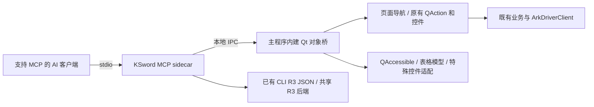

# KSword MCP 接入可行性评估

日期：2026-10-10。范围：当前工作树静态检查，以及 Qt 6.9.3、Microsoft UI Automation、MCP 官方资料研究。未启动 KSword、CLI 或驱动，未构建，也未做 UIA/MCP 端到端验收。

## 结论

**可以较快给 KSword 增加 MCP。若目标是让 AI 使用现有 GUI 的广泛功能，建议采用“外部 MCP sidecar + 本地 IPC + 主程序内建 Qt 对象桥”，复用标准控件和现有动作；Qt 无障碍作为语义补充。若目标是可靠的结构化业务调用，已有 CLI/R3 后端应优先接入。**

单靠 Qt 无障碍不能自动保证所有功能都被 MCP 完整覆盖。它能读控件、调用控件已提供的动作，但不会自动把自绘视图的内部数据、任意 C++ 方法、未创建页面、异步任务结果和驱动能力转换为业务 API。Qt 官方明确要求为自定义元素实现相应接口并发送无障碍事件。[Qt 6.9 QWidget 无障碍说明](https://doc.qt.io/archives/qt-6.9/accessible-qwidget.html)

需要区分三个目标：

- **GUI 可操作**：能找到页面、设置参数、选择目标、触发动作、读取显示结果。通用 Qt 对象桥可显著减少逐功能改造。
- **业务可调用**：直接传入 PID/地址/路径等参数，返回稳定数据、错误和完成状态。需要语义工具及明确后端适配。
- **能力边界可表达**：每项功能同时说明权限、OS/偏移支持、驱动和硬件前提；当前环境不可用时返回具体原因。

“全覆盖”可以作为逐项登记和验收的工程目标；目前没有逐功能的运行验证，不能给出有依据的覆盖百分比或固定工期。

## 已选路线与后续适配成本

当前选择路线 2：**MCP sidecar → 本地 IPC → 主程序内建 Qt 对象桥**。以持续覆盖现有 GUI 为目标，这条路线通常能把新增标准控件的适配成本降到最低；该判断是基于当前代码和控件机制的工程判断，尚未通过原型量化。

通用桥按控件类型适配，动态发现实例：普通按钮、复选框、输入框、菜单和表格共用实现，新增页面复用原有导航与工厂；lambda 连接的业务继续通过原有按钮或 QAction 入口触发。新增标准功能通常只需提供稳定 ID，必要时登记参数或结果语义。自绘控件、特殊输入和长任务仍需专用适配。

为维持这种低成本，实现时固定三条约定：

- 机器定位使用 `accessibleIdentifier` 或明确登记的页面/动作/字段 ID；临时对象 ID 只在当前实例生命周期内有效。
- 适配器按控件类型复用，特殊控件有统一扩展入口，避免在桥里持续堆积逐页面的分支。
- 区分动作已触发、字段已改变和业务已完成；结果读取与任务完成语义独立登记。

这条路线依赖 GUI 实例和当前页面状态。将来需要无界面运行或大量批处理时，可在同一个 sidecar 中增加直接调用 CLI/共享后端的工具，保持现有 GUI 桥接口。

## 当前代码已经提供哪些基础

| 静态证据 | 对接入的意义 |
| --- | --- |
| 本次只读核验随附 `.deps/Qt/6.9.3/msvc2022_64/include/`：`QtCore/qconfig.h` 第 62 行为 6.9.3；`QtGui/qtgui-config.h` 第 103 行 `QT_FEATURE_accessibility=1`；`QtWidgets/qwidget.h` 已声明 `accessibleIdentifier`。 | 本地 Qt 依赖已含无障碍支持，无需先更换框架。发行环境中的实际 provider 行为仍需验证。 |
| [MainWindow.cpp](../Ksword5.1/Ksword5.1/MainWindow.cpp) 第 6930–6937 行向全局搜索注入 Dock 目录、prepare 和 activate 回调；第 6972–6996 行列出 20 个 Dock；第 10212 行附近实现 `ensureDockContentInitialized`。 | 可以复用页面目录、导航和懒加载管理。20 个 Dock 是页面入口数量，不是业务功能总数。 |
| [GlobalUiSearch.cpp](../Ksword5.1/Ksword5.1/UI/GlobalUiSearch.cpp) 第 260、349、364–422 行已有控件树扫描与标准控件/模型识别；第 1477–1539 行按 Dock 分片扫描并使用 generation 取消。 | 现有代码证明可在主进程统一遍历大量 UI；它是搜索索引，不是动作注册表或完整覆盖清单。 |
| [coverage.md](cli/coverage.md) 和 [coverage.json](cli/coverage.json) 登记 Light R3 的 66 个迁移功能组，JSON 中有 67 个路径映射。 | 已有较大范围的 CLI 语义入口；这些数字不能代表全部主程序/R0 功能，也不是全部叶命令数量。 |
| [CommandRegistry.h](../KswordCLI/CommandRegistry.h) 第 29、58、67 行定义 `Result`、`Command` 和命令目录；[CommandRegistry.cpp](../KswordCLI/CommandRegistry.cpp) 第 27 行附近输出 `schemaVersion/command/backend/status/data/diagnostics`，区分 `partial/unsupported/failed`。 | sidecar 可以先包装支持 JSON 的 R3 命令。第 172 行附近的 legacyDefault 分流要求显式选择 R3；第 208 行附近只适配 R3，不能假定所有既有 R0 命令都拥有同一 JSON 合约。 |
| [shared R3 backend README](../shared/usermode/backend/README.md) 明确 `ks::r3` 为 Qt-free C++20 共享实现。 | 后续可直接复用共享后端，减少子进程开销；驱动功能继续经过现有 ArkDriverClient/协议层。 |
| [HexCanvas.h](../Ksword5.1/Ksword5.1/UI/MemoryWorkbench/HexCanvas.h) 第 278 行继承 `QAbstractScrollArea`，有自绘/鼠标/键盘处理；第 302 行附近已有 `CellState` 查询 API；[HexCanvas.cpp](../Ksword5.1/Ksword5.1/UI/MemoryWorkbench/HexCanvas.cpp) 第 126–127 行只设置可访问名称和描述。 | 名称和描述不能证明字节、地址、选区已成为 UIA 子元素；现有 C++ API 为薄适配提供基础。此次在主程序及 Light 源码目录未找到自定义 `QAccessibleInterface/installFactory` 实现，仍需现场检查。 |
| [WindowControlInspection.cpp](../Ksword5.1/Ksword5.1/OtherDock/WindowControlInspection.cpp) 第 278 行附近创建 MTA 的 IUIAutomation 采集客户端。 | 可借用已有 UIA 采集经验，但它消费其他窗口的信息，不是主程序的无障碍 provider 或 MCP 接口。 |
| [PluginHost.h](../Ksword5.1/Ksword5.1/PluginHost.h) 第 3–8 行明确 GUI 不加载第三方插件 DLL，第 40–50 行附近使用外部插件进程。 | Qt 对象桥应新增为主程序内建模块；不能假定现有外部插件可以反射主进程 QObject。 |

## Qt 无障碍具体能做到什么

Qt 的标准控件已提供无障碍实现。进程内可用 `QAccessible::queryAccessibleInterface(QObject*)` 取得接口，读取角色、名称、状态、父子关系，以及动作、文本、数值、选择、表格等专门接口；这些接口是否存在，取决于该控件的实现。[QAccessible 6.9.3](https://doc.qt.io/archives/qt-6.9/qaccessible.html)、[QAccessibleInterface 6.9.3](https://doc.qt.io/archives/qt-6.9/qaccessibleinterface.html)

Windows 平台把这些接口桥接成 UIA provider。Qt v6.9.3 的 `GetPatternProvider` 明确按接口和角色提供 Invoke、Value、RangeValue、Toggle、Selection、Text、Table/Grid、ExpandCollapse 等 pattern。不能由此推断任意自绘控件或所有 UIA pattern 都可用；该版本的主 provider 分派中也没有 Scroll、VirtualizedItem 和 ItemContainer 的处理分支。[Qt v6.9.3 Windows UIA provider 源码](https://raw.githubusercontent.com/qt/qtbase/v6.9.3/src/plugins/platforms/windows/uiautomation/qwindowsuiamainprovider.cpp)

`QAccessibleActionInterface` 可以定义自有 actionNames；进程内桥可直接发现并调用这些动作。外部 UIA 经过 Qt 的固定 pattern 映射，其中 Invoke 调用的是 press action，不能假定任意自定义动作都自动成为可枚举、可调用的 UIA 命令。[Qt 动作接口](https://doc.qt.io/archives/qt-6.9/qaccessibleactioninterface.html)、[Qt v6.9.3 Invoke 映射](https://raw.githubusercontent.com/qt/qtbase/v6.9.3/src/plugins/platforms/windows/uiautomation/qwindowsuiainvokeprovider.cpp)

| 场景 | 可复用能力 | 需要补齐的地方 |
| --- | --- | --- |
| 标准按钮、复选框、数值框、输入框 | 读取名称/状态，调用已有动作或修改支持的值。 | 动作合约、实际业务信号和提交时机仍要验证。 |
| QTabWidget、菜单、下拉框 | 标准可访问节点和选择/展开能力。 | 自绘导航及临时创建的右键菜单要有明确适配；重复文字不能成为唯一定位键。 |
| 标准表格/树 | 表格接口和单元格语义，可读取模型已提供的行列。 | 业务实体身份、原始类型、快照代次、过滤/树展开和增量加载边界需要显式表达。 |
| HexCanvas、图表、特殊编辑器 | 容器自身的名称、状态；有标准子控件时可读取它们。 | 绘制出来的字节/点/选区不会自动成为对应的业务接口；需自定义无障碍接口或对象桥薄适配。 |
| 未初始化的 Dock/详情页 | 可以列出静态页面目录。 | 真实控件尚未存在，须显式调用原有工厂创建指定页面。 |
| 后台扫描、监控、驱动动作 | 可触发入口，观察已经显示的状态。 | 完成、取消、部分结果、后端错误和实际回读需要任务/业务接口。 |

Qt v6.9.3 的标准表格无障碍实现从模型读取行列数和单元格；单元格名称先取 `AccessibleTextRole`，再取 `DisplayRole`。因此 UIA 并非只能读屏幕上当前可见的几个像素，但它也不会自动获得模型之外的全部原始数据或未加载内容。[Qt v6.9.3 itemviews.cpp](https://raw.githubusercontent.com/qt/qtbase/v6.9.3/src/widgets/accessible/itemviews.cpp)

### 定位应使用稳定 ID

Qt 6.9 新增的 `QWidget::accessibleIdentifier` 专门支持机器识别控件；`accessibleName/Description` 面向用户并需要本地化。Qt v6.9.3 的 Windows `AutomationId` 通过 bridge utility 优先读取 `QAccessible::Identifier`，未设置时再拼接对象名/类名与父级路径。[QWidget 6.9.3](https://doc.qt.io/archives/qt-6.9/qwidget.html#accessibleIdentifier-prop)、[Qt accessibleId 源码](https://raw.githubusercontent.com/qt/qtbase/v6.9.3/src/gui/accessible/qaccessiblebridgeutils.cpp)

建议明确注册 `pageId/actionId/fieldId`，优先为关键入口设置 `accessibleIdentifier`；展示文字作为描述和搜索辅助。不要把未设置 objectName 时的类名路径、列表行号或短期 QObject 指针当成永久业务身份。

### 无障碍调用成功不等于业务完成

`QAccessibleActionInterface::doAction` 的返回类型是 `void`；Qt v6.9.3 的 UIA Invoke provider 调用 press action 后返回 `S_OK`。它没有携带应用的任务结果或驱动回执。[QAccessibleActionInterface 6.9.3](https://doc.qt.io/archives/qt-6.9/qaccessibleactioninterface.html)、[Qt UIA Invoke provider 源码](https://raw.githubusercontent.com/qt/qtbase/v6.9.3/src/plugins/platforms/windows/uiautomation/qwindowsuiainvokeprovider.cpp)

对象桥也不能仅用“一律 setProperty”实现所有输入。`QLineEdit::setText` 不触发 `textEdited`，且插入文本不经过 validator 验证；`QComboBox::activated` 只由用户交互触发。程序改值后显示正确，业务处理仍可能没有发生。[QLineEdit 6.9.3](https://doc.qt.io/archives/qt-6.9/qlineedit.html)、[QComboBox 6.9.3](https://doc.qt.io/archives/qt-6.9/qcombobox.html)

KSword 有实际对应案例：[MemoryDebugPage.cpp](../Ksword5.1/Ksword5.1/MemoryDock/MemoryDebugPage.cpp) 第 116 行由 `activated` 打开模块；[HexGotoBar.cpp](../Ksword5.1/Ksword5.1/UI/MemoryWorkbench/HexGotoBar.cpp) 第 257 行监听 `textEdited`。这类入口需要薄适配，不能仅验证控件值发生变化。

标准按钮的 `click()` 会触发对应点击信号并尊重 disabled；QAction 的 `trigger()` 会触发既有动作。由这些入口连接的 lambda 业务不必先改成可反射方法。字段编辑和自定义输入则要通过少量适配保留真实校验、编辑、提交语义。[QAbstractButton 6.9.3](https://doc.qt.io/archives/qt-6.9/qabstractbutton.html#click)、[QAction 6.9.3](https://doc.qt.io/archives/qt-6.9/qaction.html#trigger)

## 三条接入路线的取舍

| 路线 | 主程序改动 | 优点 | 覆盖边界 |
| --- | --- | --- | --- |
| 外部 MCP → Windows UIA | 初始试探可不修改主程序。 | 快速验证现有 GUI 可访问性；与具体语言实现耦合较少。 | 受 provider 实现、页面生命周期、权限/桌面、菜单和任务结果限制；不能保证全覆盖。 |
| MCP sidecar → 本地 IPC → 内建 Qt 对象桥 | 一个统一桥模块，主窗口启动/目录钩子，标准控件适配；少量特殊控件适配。 | 直接看到 QAction、QObject、模型和原有导航，能复用现有业务信号；适合快速扩大 GUI 覆盖。 | 仍需补足临时菜单、自绘数据和异步完成语义；不是任意 C++ 反射。 |
| MCP → CLI/共享业务后端 | 已有 R3 CLI 的首批包装无需改变 GUI；其余逐项适配。 | 参数、结果、错误、取消和无 UI 使用最清晰。 | 目前 CLI 清单范围是 Light R3；全主程序功能需登记并接入对应后端。 |

针对“快速使用大量现有功能”，第二条最值得投入；针对“尽快拿到可靠的结构化业务工具”，先包装现有 R3 CLI。两条可共用同一个 sidecar，纯外部 UIA 作为验证和补充入口。

Windows 的 UIPI/完整性级别会限制较低权限的自动化客户端操作较高权限窗口；登录/安全桌面也有独立边界。外部 UIA 必须在目标部署环境验证，不能假定普通权限 MCP 进程天然可操作管理员 KSword。[Microsoft UIA 权限说明](https://learn.microsoft.com/en-us/windows/win32/winauto/uiauto-securityoverview)

## 建议的最小实现

sidecar 负责 MCP 协议、参数和结果合约；主程序内建桥负责原有页面/控件/动作和快照。QAccessible 是本机接口而不是 MCP 传输层，外部 sidecar 不能直接解引用主进程 QObject；IPC 是两者的边界。

Qt 元对象可枚举已登记的属性和方法，但普通 C++ 方法未用 slots/Q_INVOKABLE 等登记时不能按字符串调用。`Q_OBJECT` 不会把整类 public API 自动转换为远程函数。桥应提供固定的类型化适配，而不是开放任意方法名/任意属性写入。[QObject 6.9.3 的 Q_INVOKABLE 说明](https://doc.qt.io/archives/qt-6.9/qobject.html#Q_INVOKABLE)

| 首批工具示意 | 作用和约束 |
| --- | --- |
| `ksword_pages` | 返回注册页面及 initialized/available 状态；不因列目录而初始化全部 Dock、启动全部采样器。 |
| `ksword_open_page` | 按稳定 pageId 调用原有 prepare/activate，返回实际初始化结果。 |
| `ksword_ui_snapshot` | 按页面/子树读取控件、状态、当前值、允许动作、表格摘要；有深度/节点预算。 |
| `ksword_ui_action` | 调用明确登记的按钮/QAction/无障碍动作，检查当前 enabled、modal 状态、对象代次和原有目标校验。 |
| `ksword_set_field` | 类型化设置参数并执行对应编辑/提交语义，返回校验/回读结果。 |
| `ksword_read_table` | 按快照读取指定行列范围，返回字段、实体 ID、过滤/加载状态和分页信息。 |
| `ksword_job_status` | 对接现有任务完成/取消信号，区分 accepted、running、partial、completed、failed、cancelled。 |
| 少量业务工具 | 先包装已支持 R3 JSON 的 CLI 命令，后续复用共享后端。 |

这是建议的工具面，当前仓库尚未实现这些 MCP 工具。通用 UI 工具可减少工具数量；具体能力发现通过页面/动作目录实现。正式业务工具需要 typed inputSchema、outputSchema 和动作说明，不能仅从 CLI 的 syntax 文本自动推导完整合约。

Qt widget 和连接到 view 的模型必须在 GUI 线程使用。IPC/协议层排队到 GUI 线程，按子树/行范围分片读取并返回值快照；不要在 GUI 线程同步等待客户端，也不要让网络线程直接遍历控件或模型。`invokeMethod(..., QueuedConnection)` 可用于投递，`BlockingQueuedConnection` 在同线程使用会死锁。[Qt 6.9 线程与 QObject](https://doc.qt.io/archives/qt-6.9/threads-qobject.html)、[QAbstractItemModel 线程边界](https://doc.qt.io/archives/qt-6.9/qabstractitemmodel.html#thread-safety)、[QMetaObject 6.9.3](https://doc.qt.io/archives/qt-6.9/qmetaobject.html)

若 sidecar 另用外部 UIA，UIA 查询/订阅在独立 MTA 线程进行。Microsoft 明确指出在 UI 线程自动化自己的窗口可能造成缓慢或无响应；该规则与“直接访问 Qt 控件必须在 GUI 线程”属于两个不同调用路径。[Microsoft UIA 线程说明](https://learn.microsoft.com/en-us/windows/win32/winauto/uiauto-threading)

本地 IPC 可用 `QLocalServer/QLocalSocket`。Qt 文档说明 Windows 的 `UserAccessOption` 能限制同用户连接，同时允许同用户的未提权进程连接提权 server。因而它解决连接可达性，并不自动构成逐动作授权；应由主程序显式开启桥、建立配对会话、限制允许动作并保留原有目标校验/确认。[QLocalServer 6.9.3](https://doc.qt.io/archives/qt-6.9/qlocalserver.html#socketOptions-prop)

## MCP 层需要保留的合约

本次核对时，官方 `latest` 指向 **2026-07-28**。该版相较旧版已经改变请求元数据和连接握手语义；实现应选与目标客户端兼容的官方 SDK/协议版本，不能把旧示例报文直接套到最新版。[MCP 2026-07-28 transport 与兼容说明](https://modelcontextprotocol.io/specification/2026-07-28/basic/transports)、[官方 SDK 目录](https://modelcontextprotocol.io/docs/2026-07-28/sdk)

首版外部接口建议 stdio：客户端启动 sidecar，标准输入/输出承载换行分隔 JSON-RPC，诊断写 stderr，stdout 只写有效 MCP 消息。MCP 的 tools/list 与 tools/call 支持发现和调用；inputSchema 描述输入，outputSchema 校验 structuredContent。结果同时附带简洁文本有助于旧客户端兼容。[MCP stdio](https://modelcontextprotocol.io/specification/2026-07-28/basic/transports/stdio)、[MCP tools](https://modelcontextprotocol.io/specification/2026-07-28/server/tools)

建议应用结果统一用对象形态 `{schemaVersion, backend, status, data, diagnostics, ...}`；列表包在 `data/items` 下。2025-11-25 的 structuredContent 要求 JSON 对象，2026-07-28 允许符合 schema 的任意 JSON 值，对象封装便于两代兼容。业务执行错误应通过工具错误结果表达，并保留 partial/unsupported 等业务状态；不能因为按钮调用返回成功就报告操作完成。[MCP 2025-11-25 structured content](https://modelcontextprotocol.io/specification/2025-11-25/server/tools#structured-content)、[MCP 2026-07-28 structured content](https://modelcontextprotocol.io/specification/2026-07-28/server/tools#structured-content)

UI 数据结果应明确说明后端、快照时间/代次和已加载范围。表格行号只用于当前快照分页，进程/窗口/内存动作继续用现有实体身份复核；监控和扫描返回 jobId，再取得实际完成结果。CLI 包装使用固定 executable 与参数数组，明确 `--backend r3 --json`，不拼接 shell 命令；未适配的 R0 文本入口不能冒充统一 JSON 后端。

## 如何验证“覆盖所有功能”

先建立按功能而非控件计数的矩阵：每项登记入口、参数、目标身份、执行入口、完成信号、结果读取及能力前提。状态至少区分“仅可发现”“GUI 可操作”“业务结果已验证”和“当前环境不可用”。页面目录、搜索命中数、CLI 路径数都不能替代这张矩阵。

最有信息量的首批原型是：一个尚未创建的 Dock、普通按钮加输入框、一个动态表格、一个临时右键菜单、HexCanvas 读/选区薄适配、一个异步扫描的完成与取消。它们可以验证通用桥是否承担了主要工作，以及哪些例外确实需要逐控件/逐功能适配。

后续运行验收应分别记录 Qt 对象桥/UIA/CLI 三种路径的结果，并覆盖中文/英文、详情窗口关闭重建、表格刷新与排序、模态确认、目标退出、提权和能力不支持等实际状态。驱动或硬件功能仍需对应真实环境验收。当前完成的是可行性研究和接口方案，尚无任何 MCP 或全功能覆盖的运行通过结论。
